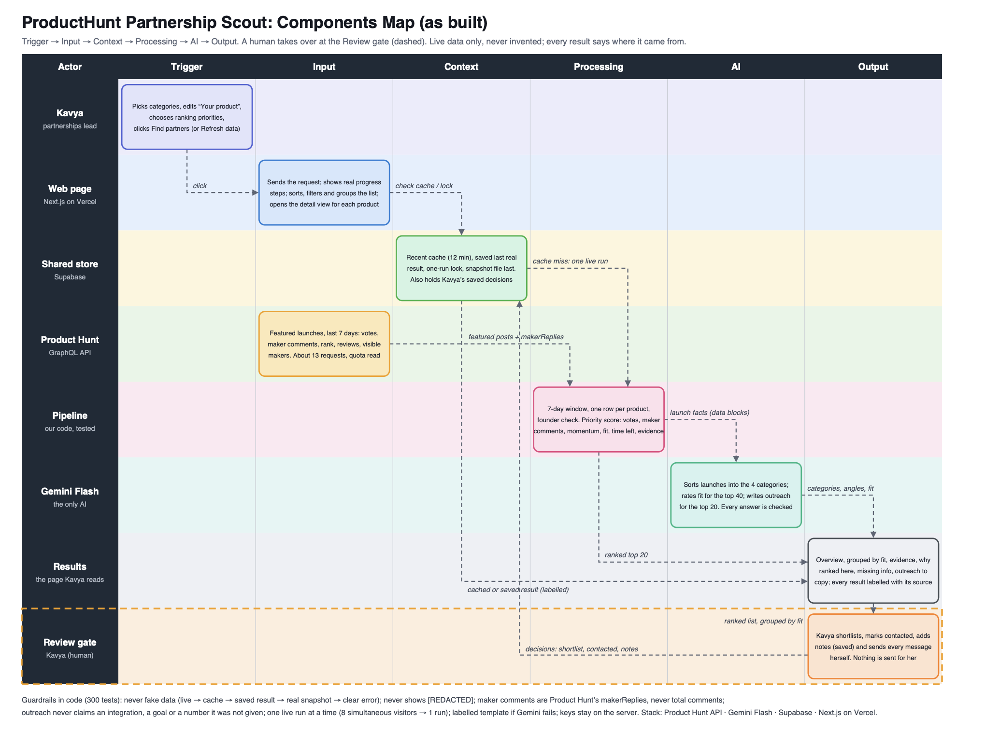
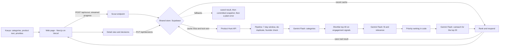

# Components map

The system as built and deployed. A one-page visual version (swimlane: Actor, Trigger, Input, Context, Processing, AI, Output, with the
human Review gate dashed) is in `docs/components-map.pdf` (real, selectable text) and `docs/components-map.png`.

## Data flow for one click (text version)

## Components

| Component | Files | Job | Input → output | If it fails |
|---|---|---|---|---|
| Web page | `app/page.tsx`, `app/scout.tsx`, `app/ui/*` | Controls, real progress, ranked workspace (grouping, sorting, filters), detail dialog, decisions | clicks → rendered list | Plain message and a retry button; never a blank screen |
| Scout endpoint | `app/api/scout/route.ts`, `lib/scout.ts` | One search per click: lock, cache, pipeline, save | categories, product text, priorities → streamed steps, then the result | Structured error line; falls back to saved result, snapshot |
| Product Hunt client | `lib/producthunt.ts` | 20 featured posts per request, quota headers | 7-day window → raw posts | Retry once; 429 or outage → fallbacks; wrong token → setup message |
| Pool builder | `lib/pool.ts`, `lib/dates.ts`, `lib/founder.ts` | Window rules, de-duplication, Product Hunt URL guard, founder and maker details | raw posts → candidate pool | Bad records are dropped, never repaired |
| AI client | `lib/gemini.ts`, `lib/prompts.ts`, `lib/validate.ts` | Gemini Flash calls with structured JSON; shared text checks | prompt → parsed JSON | Error kinds (one word); no key in any message |
| Category sorter | `lib/classify.ts`, `lib/categories.ts` | Four categories per launch | launches → categories + reason | Labelled Product Hunt topic table |
| Fit rater | `lib/fit.ts` | strong / partial / weak plus one grounded sentence | shortlist → ratings | Left unrated (neutral, flagged) |
| Outreach writer | `lib/outreach.ts` | Connection, hypothesis, message, question, caveat | top 20 → outreach | Labelled template from the listing |
| Priority ranking | `lib/scoring.ts`, `lib/priority.ts`, `lib/evidence.ts`, `lib/explain.ts` | Core score, priority score, evidence, responsiveness, "why" | pool + fits → ranked rows | Pure code; deterministic |
| Shared store | `lib/store.ts`, `lib/bundle.ts`, `supabase/schema.sql` | Cache, saved result, lock, decisions | key/value | Memory fallback; storage calls time out in 6 s |
| Decisions | `lib/decisions.ts`, `lib/decisionsClient.ts`, `app/api/decisions/route.ts` | Shortlist, contacted, notes per browser workspace | updates → saved decisions | Kept in the browser with a clear message |
| Quota guard and lock | `lib/scout.ts` | No live attempt when quota is low; one live run at a time | quota headers, lock row | Visitors get the saved result, labelled |
| Observability | `lib/log.ts`, `app/api/health/route.ts` | Structured JSON logs; settings check; Gemini ping | events → log lines | Logging never breaks a request |
| Snapshot | `data/last-good-snapshot.json`, `scripts/snapshot.live.ts` | Real capture, last layer before an error | live run → file | Ignored if its schema is old |

## Fallback order (never fake data)
live Product Hunt → recent cache (12 min) → saved last real result → committed snapshot → a plain error. Every layer is labelled on screen with its time.
Only the AI parts degrade independently: categories fall back to Product Hunt topics, fit becomes unrated, outreach becomes a labelled template.
